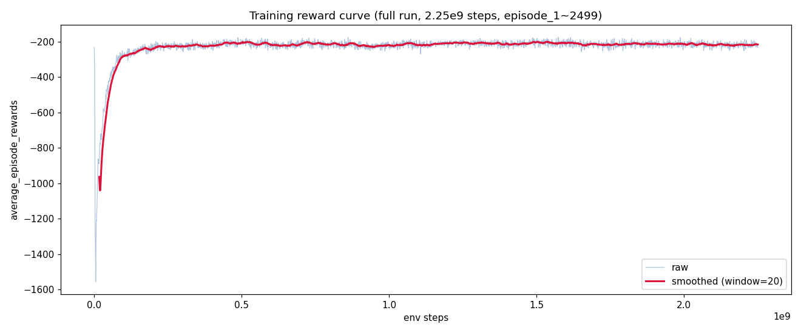
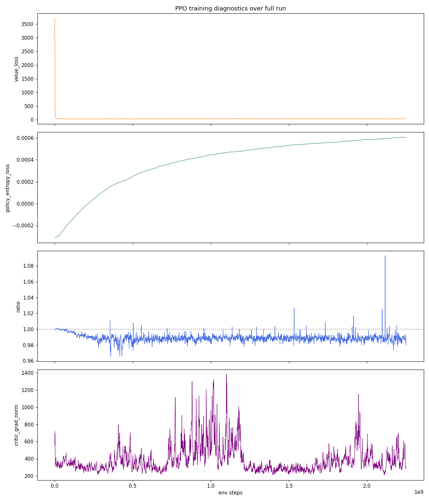
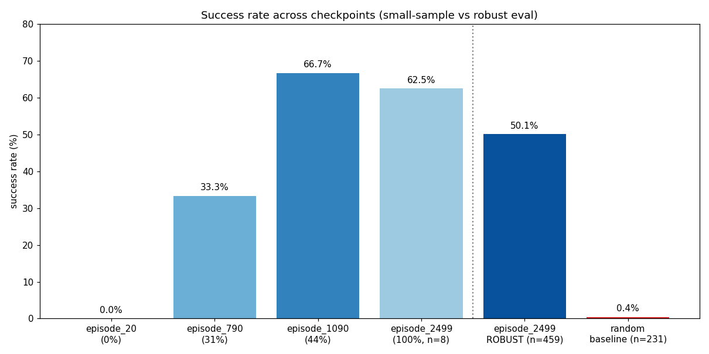
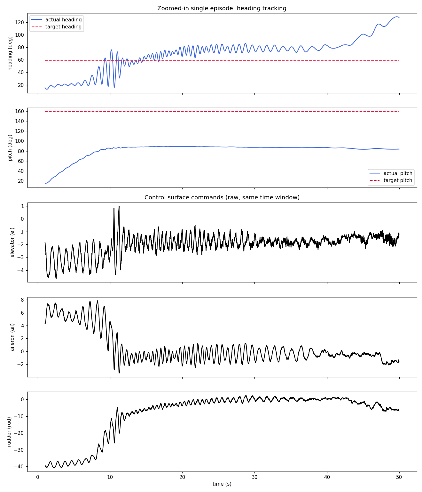
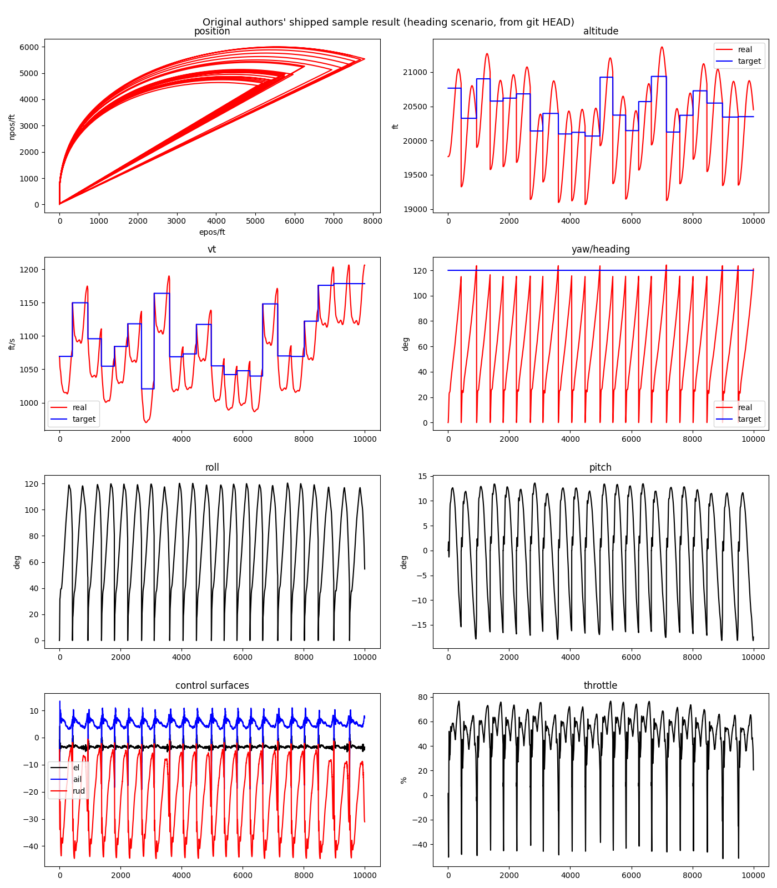

# NeuralPlane F16 PPO 학습 실험 기록 (control scenario)

작성일: 2026-11-13 / 환경: RTX 5080 Laptop GPU (Blackwell, 16GB VRAM), Linux
이 문서는 2026-11-10 ~ 11-13 동안 진행한 첫 강화학습 실험 전체 과정을 기록한 것. 나중에 보고서 작성 시 참고용.

---

## 1. 환경 구축

- Anaconda + `conda_env.yml` / `requirement.txt` 기반 환경 `Neuralplane` 생성
- 문제 1: `gym==0.21.0`이 최신 `setuptools`/`pip` build isolation과 충돌 → `setuptools==65.5.0`, `wheel==0.38.4`, `pip==24.0`으로 다운그레이드 후 `--no-build-isolation` 설치로 해결
- 문제 2: GPU가 RTX 5080 Laptop(Blackwell, `sm_120`)인데 레포 기본 `torch==2.0.1+cu117`은 Blackwell 커널 미지원 → `RuntimeError: CUDA error: invalid device ordinal` 발생
  - 해결: `torch==2.11.0`, `torchvision==0.26.0`, `torchaudio==2.11.0` (cu128 빌드, `--extra-index-url https://download.pytorch.org/whl/cu128`)로 업그레이드. `conda_env.yml`, `requirement.txt` 둘 다 수정 (현재 git에 staged, 커밋은 git identity 미설정으로 보류 중)
- 문제 3: `scripts/train_control.sh`에 `device="cuda:1"`이 하드코딩되어 있었는데 GPU가 1개뿐이라 `cuda:0`으로 수정

## 2. GPU 메모리(OOM) 이슈와 하이퍼파라미터 축소

- 레포 기본값(`n-rollout-threads 3000`, `num-mini-batch 5`)으로 학습 시 `torch.OutOfMemoryError` 발생
  - 원인: PPO 업데이트 시 mini-batch 크기 = `n_rollout_threads * buffer_size / data_chunk_length / num_mini_batch` 가 16GB VRAM에 비해 너무 큼 (저자들은 아마 A100/H100급 서버 GPU를 사용했을 것으로 추정 — README에도 사용 하드웨어 명시 없음)
  - 조치: `n-rollout-threads 3000→300`, `num-mini-batch 5→50`로 축소 (`train_control.sh`, `train_heading.sh` 동일 적용, 원래 값은 스크립트에 주석으로 남겨둠)
  - **주의할 점:** 이 축소는 "같은 학습을 더 잘게 나눈 것"이 아니라, PPO 업데이트 1회가 보는 데이터 양이 줄어들어 **gradient 추정 노이즈가 커지는 구조적 차이**를 만듦. 아래 5번 "진동 현상"의 원인 후보 중 하나로 의심됨.

## 3. 학습 실행 정보

| 항목 | 값 |
|---|---|
| 스크립트 | `scripts/train_control.sh` |
| env / scenario | `Control` / `control` (랜덤 pitch·heading·속도 목표 추종) |
| model | F16 |
| seed | 0 |
| device | cuda:0 |
| n-rollout-threads | 300 (원본 3000) |
| num-mini-batch | 50 (원본 5) |
| buffer-size | 3000 |
| num-env-steps (목표) | 2.25e9 |
| lr / gamma / ppo-epoch / clip | 3e-4 / 0.99 / 16 / 0.2 |
| entropy-coef | 1e-3 |
| hidden / recurrent-hidden | 128 128 / 128 |
| 시작 시각 | 2026-11-10 19:52:40 |
| 종료 시각 | 2026-11-13 01:54:02 |
| 총 소요시간 | 약 54시간 2분 |
| 총 episode | 2500 (episode_1 ~ episode_2499 체크포인트 저장) |
| 스텝 달성률 | 2,250,000,000 / 2,250,000,000 (100%) |

## 4. 학습 곡선 (reward)



- 0~18M 스텝: -230 → **-864**로 급락 (초기 탐험 구간, 정상)
- 18M~150M 스텝: -864 → 약 -250까지 빠르게 회복
- **150M~2.25B 스텝 (학습의 93%에 해당하는 구간): -185 ~ -245 사이에서 정체(plateau), 뚜렷한 추가 개선 없음**
- 최종 구간(2.2B~2.25B) 평균도 -200 ~ -230 수준으로 중간 지점과 거의 동일



- `value_loss`: 33~35에서 정체 (critic이 더 이상 정확도를 못 높임)
- `policy_entropy_loss`: 거의 0 → **정책이 일찍 확정적(deterministic)으로 수렴, 탐험 부족 의심**
- `ratio` (PPO importance ratio): 0.98~0.99로 1에 가까움 → 업데이트가 매우 보수적 (clip이 거의 안 걸림)
- `critic_grad_norm`: 496~1101로 들쭉날쭉 (critic이 actor보다 불안정)

## 5. 평가 결과 — 체크포인트별 success rate



| 체크포인트 | 진행률 | 평가 방식 | episode 수 | success rate | avg reward/episode |
|---|---|---|---|---|---|
| episode_20 | 0.8% | 단일 env, 10000 step | 4 | 0.0% | -1046.1 |
| episode_790 | 31% | 단일 env, 10000 step | 6 | 33.3% | -361.4 |
| episode_1090 | 44% | 단일 env, 10000 step | 9 | 66.7% | -134.5 |
| episode_2499 (최종) | 100% | 단일 env, 10000 step | 8 | 62.5% | -202.8 |
| **episode_2499 (최종, robust)** | 100% | **200개 병렬 env, 3000 step** | **459** | **50.1%** | **-275.4** |
| random/untrained baseline | - | 200개 병렬 env, 3000 step | 231 | 0.4% | -2567.2 |

**중요한 교훈:** 단일 env로 8~9번의 episode만 보고 측정한 success rate(62.5%, 66.7%)는 표본이 너무 작아 노이즈가 큼. 459 episode로 재측정한 **robust 추정치는 50.1%**로, 이게 이 모델의 실제 성능에 더 가까운 수치로 판단됨. (raw 로그: `eval_robust_raw_log.txt`, 재현 스크립트: `scripts/eval_robust.py`)

**베이스라인 대비 효과:** 학습 안 된 랜덤 정책(success 0.4%) 대비 학습된 정책(50.1%)은 명확한 개선 — 학습 자체는 유의미했음을 확인.

## 6. 비행 거동(진동) 문제 — 정성적 진단

GIF 애니메이션 (실제 궤적 + 목표값 비교):
- `images/flight_episode_790.gif` — episode_790 체크포인트, 목표값 표시 없는 초기 버전
- `images/flight_episode_790_with_targets.gif` — episode_790, 목표값(점선) 포함
- `images/flight_episode_1090_with_targets.gif` — episode_1090, 목표값 포함 (790 대비 개선된 추종 확인됨)

정량적 증거 (episode_2499 평가 데이터, 단일 episode 구간 49초 확대):



- heading이 목표값 근처에서 **정착하지 못하고 지속적으로 진동**
- elevator/aileron/rudder 조종면 명령이 고주파로 흔들림
- elevator 방향 반전(direction reversal) 비율: **53.6%** (스텝의 절반 이상에서 조종 방향이 바뀜)
- episode 내 heading 오차 표준편차: **26.4도**
- (재현 스크립트: `scripts/inspect_oscillation.py`)

### 원인 분석
`envs/reward_functions/posture_reward.py`:
```python
reward_pitch = -delta_pitch ** 2
reward_heading = -delta_heading ** 2
reward_vt = -delta_vt ** 2
reward_target = reward_pitch + reward_heading + reward_vt
```
`control_task.py`가 사용하는 reward는 `PostureReward`(순간 오차 제곱) + `EventDrivenReward`(성공/실패 ±200) 뿐이며, **조종면 변화율/진동에 대한 페널티가 전혀 없음**. 즉 흔들리는 비행은 버그가 아니라 reward 설계상 "흔들려도 혼나지 않는" 구조에서 자연스럽게 나온 결과로 판단됨.

### 대안 가설
진동의 원인이 (a) reward 설계 문제인지, (b) 2번 항목에서 축소한 배치 크기(noisy gradient) 때문인지는 아직 확정하지 못함 — 둘 다 그럴듯한 후보. 구분하려면 추가 실험 필요.

### 저자 공식 샘플 데이터와의 비교

레포 git 기록(`HEAD`)에 커밋되어 있던 저자들의 원본 샘플 결과(`renders/result/*.npy`, heading 시나리오)를 복원해서 플롯해봄:



- roll이 0→120도를 계속 반복해서 오르내리고, yaw도 톱니 패턴으로 0→120도를 반복 (목표 120도에 정착하지 못함)
- altitude는 목표 대비 ±1000~1500ft, vt(속도)도 목표 대비 지속적으로 오버슈트하며 진동
- **저자들의 공식 데모 결과조차 목표에 안정적으로 정착하지 못하고 계속 진동/오버슈트하는 패턴을 보임**

**이 비교가 뒷받침하는 것:** 진동 현상이 우리가 축소한 배치 크기 때문에 생긴 게 아니라, 이 reward 설계(순간 오차만 벌점, smoothness 벌점 없음)의 **일반적인 특성**일 가능성이 높다는 정성적 근거.

**이 비교가 증명하지 않는 것(과장 금지):**
1. 이 샘플은 heading 시나리오, 우리가 학습한 건 control 시나리오라 과제가 달라 수치 직접 비교 불가
2. 저자들이 이 샘플을 만들 때 어떤 batch 설정(원본 3000/5 여부)을 썼는지 알 수 없음
3. "패턴이 비슷하게 흔들린다"는 정성적 증거일 뿐, **"배치를 축소해도 success rate 등 전체 성능이 동일하다"는 정량적 증명은 아님** — 이 둘은 서로 다른 주장이므로 혼동하지 않아야 함

## 7. 오픈소스 수정에 대한 입장 정리

- README: "We believe that NeuralPlane can ... serve as **a new challenging benchmark for the RL community**" — 완성된 해답이 아니라 연구자들이 개선하도록 열어둔 벤치마크/baseline으로 공식 소개됨
- 논문/README 어디에도 success rate 등 구체적 성능 수치가 명시되어 있지 않음 → 저자들도 수치로 "이 정도면 끝"이라 보장한 적 없음
- 결론: reward function이나 하이퍼파라미터를 수정/실험하는 것은 "완성품을 훼손하는 것"이 아니라 **연구 벤치마크를 가져다 쓰는 정상적인 과정**으로 판단

## 8. VRAM(16GB) 제약 해결 옵션 (검토만 함, 아직 미적용)

| 옵션 | 설명 | 장단점 |
|---|---|---|
| Mixed precision (fp16/bf16) | `torch.cuda.amp.autocast` + `GradScaler` | 코드 변경 적음, 메모리 절반 수준 절약 |
| Gradient accumulation | 작은 배치로 쪼개 forward/backward 후 gradient만 누적, 마지막에 한 번만 optimizer.step() | 저자 원본 설정과 통계적으로 동등한 효과, 코드 수정 필요(`ppo_trainer.py`) |
| 클라우드 GPU 대여 | A100/H100 등 대여 (시간당 $1~2) | 코드 변경 없이 저자 원본 설정 그대로 검증 가능, 비용 발생 |
| Gradient checkpointing | 중간 activation 재계산으로 메모리 절약 | recurrent 구조라 적용 복잡도 있음 |

## 9. 열린 질문 / 다음 단계 (결정 안 됨)

1. 평가용 eval 환경 수(`num_envs`)는 늘려도 안전하다는 것을 확인함(200개, 2.7GB 사용). 학습용 `n-rollout-threads`를 다시 올릴 수 있는지는 **PPO update 순간의 피크 메모리**를 별도로 측정해야 확실함 (아직 안 함)
2. 진동 문제의 원인이 reward 설계 vs 배치 크기 중 무엇인지 구분 실험 필요
3. reward에 smoothness/제어 안정성 페널티를 추가할지 여부 — 사용자 승인 대기 중, 아직 코드 미수정
4. 여러 random seed로 재학습해서 지금 결과(success 50%)가 재현되는지 확인 (RL은 seed별 분산이 커서 표준 관행상 권장되나, 1회 학습에 이미 54시간 소요되어 비용 큼)
5. `conda_env.yml`/`requirement.txt`의 torch 업그레이드 커밋이 git identity 미설정으로 보류 중

---

## 부록: 폴더 구성
```
renders/analysis_report/
├── REPORT.md                  (이 문서)
├── eval_robust_raw_log.txt    (로버스트 평가 원본 로그)
├── images/
│   ├── reward_curve_full.png
│   ├── training_diagnostics.png
│   ├── success_rate_progression.png
│   ├── oscillation_evidence.png
│   ├── flight_episode_790.gif
│   ├── flight_episode_790_with_targets.gif
│   └── flight_episode_1090_with_targets.gif
└── scripts/
    ├── eval_robust.py          (robust 평가 재현용)
    ├── inspect_oscillation.py  (진동 증거 재현용)
    └── animate_flight_v2.py    (GIF 생성 재현용)
```
